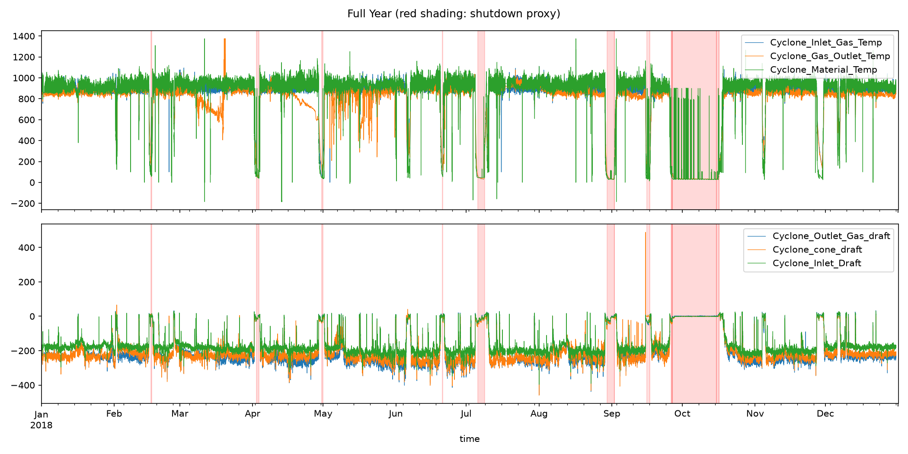

# Cyclone Operations Lab

I built this project to explore cyclone sensor behavior and answer questions from cyclone technical manuals with page citations. It includes a reproducible time-series analysis, a local retrieval and generation prototype, two executed notebooks, and an interactive dashboard.



## What I found

| Measure | Result | Interpretation |
| --- | ---: | --- |
| Sensor observations | 377,719 | January 2017 through August 2020 |
| Missing five-minute timestamps | 861 | Kept missing rather than filled |
| Shutdown candidates | 77 events, 5,156.4 hours | Rule-based proxy requiring operator validation |
| Active operating states | 6 clusters | Descriptive sensor regimes |
| Anomaly candidates | 926 events | State-relative robust deviations |
| One-hour forecast RMSE | 19.48 | Gradient boosting; persistence: 22.68 |
| Searchable PDF chunks | 382 | Extracted from 11 supplied PDFs |

Sensor units are not documented in the source workbook, so forecast errors use native sensor units. I treat shutdowns and root causes as hypotheses because operator and maintenance labels were not supplied.

## Explore the project

| Area | Where to start |
| --- | --- |
| Sensor analysis | [Executed notebook](notebooks/sensor_analysis.ipynb), [methods and outputs](sensor_analysis/README.md) |
| Document Q&A | [Executed notebook](notebooks/document_qa.ipynb), [prototype instructions](document_qa/prototype/README.md), [design notes](document_qa/notes.md) |
| Interactive demo | [Dashboard source](dashboard/app.py) |
| Presentation | [Final deck](reports/Final_Presentation.pptx) and [architecture diagram](document_qa/architecture_diagram.pptx) |
| Verification | [Report](reports/TEST_REPORT.md) |

The original workbook, assignment brief, and eleven PDFs are in `docs/`. Derived CSVs and plots live beside the relevant analysis code. The `dist/` folder holds the final submission ZIP when built.

## Set up locally

Use Python 3.12. The commands below run from the repository root in PowerShell:

```powershell
py -3.12 -m venv .venv
.\.venv\Scripts\Activate.ps1
python -m pip install -r requirements.txt
python sensor_analysis/task1_analysis.py
python -m sensor_analysis.enrich_report
python document_qa/prototype/rag_prototype.py --rebuild
python scripts/run_dashboard.py
```

On macOS or Linux, create the environment with `python3.12 -m venv .venv` and activate it with `source .venv/bin/activate`. The first index build downloads the open models `sentence-transformers/all-MiniLM-L6-v2` and `google/flan-t5-small`; later runs reuse the local cache. The dashboard launcher starts Streamlit from `dashboard/`, so `dashboard/.streamlit/config.toml` supplies its theme.

Open the notebooks from the repository root with:

```powershell
jupyter lab notebooks/sensor_analysis.ipynb
jupyter lab notebooks/document_qa.ipynb
```

The notebooks contain executed outputs for quick review. The sensor script performs full clustering, anomaly detection, plotting, and forecast fitting. The Task 2 notebook inspects PDF ingestion, chunk lengths, hybrid retrieval, a cited answer, and the small evaluation. Rebuild the FAISS index before running the Task 2 notebook on a fresh checkout.

## Method and output guide

**Sensor data.** I parse timestamps and numeric readings, retain communication-error counts, and reindex onto a strict five-minute grid. I do not fill missing sensor values. A shutdown candidate requires both gas temperatures below 150 and absolute inlet draft below 30 for at least 30 consecutive minutes. Complete active rows enter MiniBatch KMeans; a sampled silhouette score chooses among 3–6 states. Within each state, robust MAD-based sensor deviations produce anomaly candidates. Twelve direct gradient-boosting models forecast inlet gas temperature 5–60 minutes ahead on a chronological train, validation, and test split. Required CSVs and PNGs are under `sensor_analysis/`.

**Document Q&A.** The prototype extracts PDF text with page provenance, makes overlapping 150-word chunks, combines MiniLM/FAISS dense retrieval with BM25, and fuses rankings. FLAN-T5-small generates an answer from retrieved excerpts. The response includes source document and page references. Low-relevance questions abstain. The index under `document_qa/prototype/index/` and downloaded model files are local build artifacts.

## Check and package

```powershell
python -m pytest -q
python document_qa/prototype/evaluate.py
python scripts/package_submission.py
```

The package script writes `dist/Milan_Tony_DataScience.zip`. The ZIP keeps the working project layout and includes copies under the assignment's required `Task1/` and `Task2/` names. It also places `Final_Presentation.pptx` at the ZIP top level. The script verifies the archive and required deliverables. The test report records the executed checks and their limits.

## Limits and next steps

The shutdown rule has no ground-truth labels. Cluster names summarize sensor patterns rather than verified machine conditions. Anomaly explanations need maintenance logs and operator review. The four-question RAG evaluation is a smoke test, and page citations do not prove every generated claim. Before operational deployment, I would validate event labels, evaluate forecasts around shutdown transitions, expand the document question set, and measure answer faithfulness with human review.

`.gitattributes` keeps PDFs, spreadsheets, slides, images, and compressed labels as binary Git objects and normalizes Python and Markdown line endings. `requirements.txt` is the single dependency list; the local virtual environment and model cache are excluded from Git.
